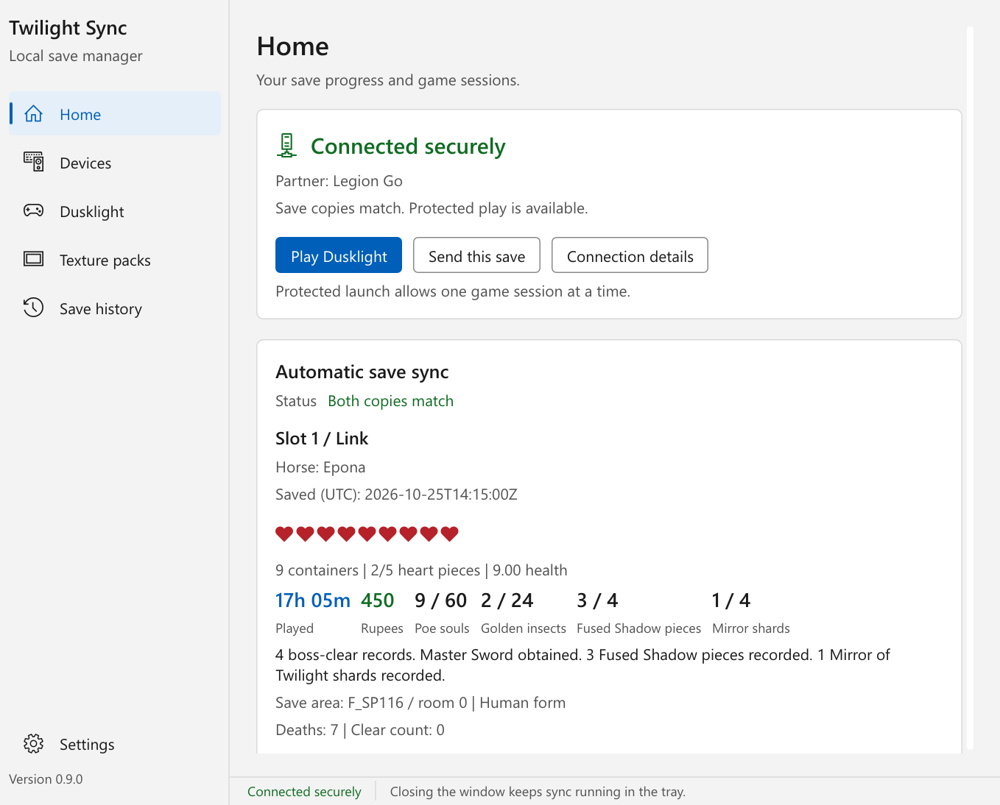
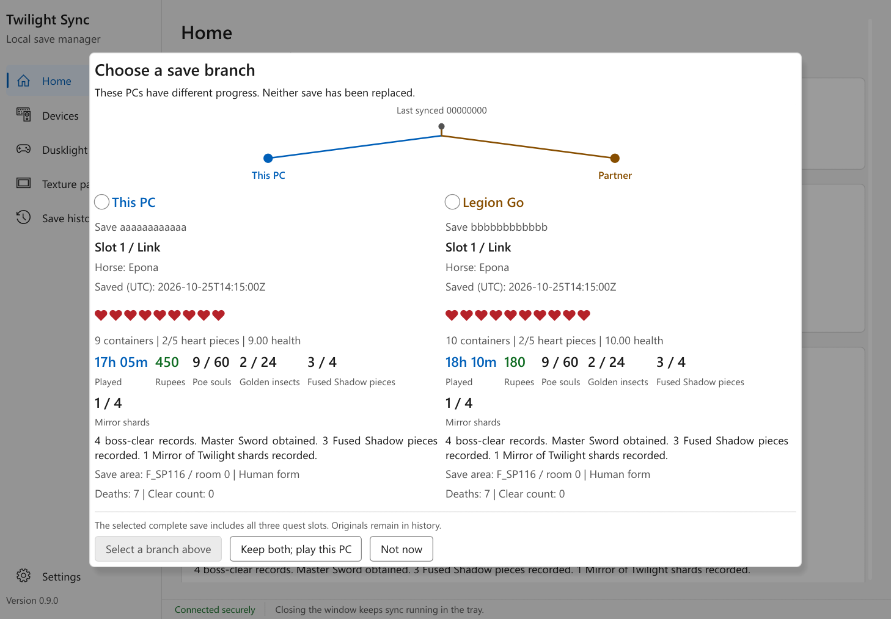
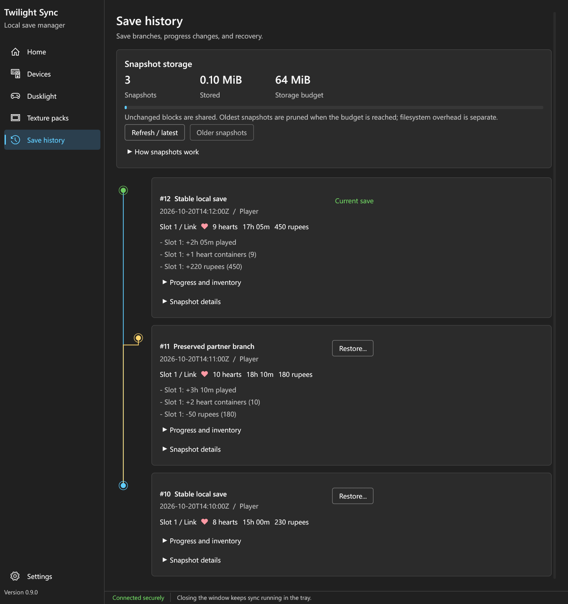

# Twilight Sync

**Your Twilight Princess adventure, across your desktop and handheld.**

Keep your [Dusklight](https://twilitrealm.dev/) saves in sync between two Windows
PCs over your home network. Play offline, pick up on the other PC when you
reconnect, and compare your progress before resolving a save conflict. No cloud
account, subscription, or administrator access required.

[Download for Windows](https://github.com/false00/twilight-sync/releases/latest) ·
[Report an issue](https://github.com/false00/twilight-sync/issues) ·
[Technical guide](docs/guide.md)

**Windows 10/11 x64** | **Encrypted LAN sync** | **Offline play** | **MIT licensed**



*The native Windows app, shown with example save and device data. Light and dark
themes are included. No game assets or real save files are bundled.*

## Built for picking up where you left off

- **Desktop to handheld:** pair two PCs once and sync over your home network.
- **No connection required to play:** keep playing offline, then sync or compare
   your progress when both PCs are back online.
- **See what you are choosing:** compare hearts, play time, items, collectibles,
   and recorded milestones before replacing a save.
- **Keep a way back:** preserved branches and compact snapshots let you restore
   an earlier version. Different progress never silently picks a winner.

## Install with one PowerShell command

Open **PowerShell as your normal Windows user**, not as administrator, and run:

```powershell
irm https://raw.githubusercontent.com/false00/twilight-sync/main/install.ps1 | iex
```

**Requirements:** Windows 10/11 **x64** (Intel/AMD), PowerShell 5.1 or newer, and
a working graphics driver for the native dashboard. No Rust, Visual Studio,
account, or administrator access is required for the downloaded app.

Windows PowerShell 5.1 and PowerShell 7 are both supported, including 32-bit
PowerShell on x64 Windows handhelds such as the Legion Go.

**The app is currently unsigned.** Windows may show an unfamiliar-publisher
warning, and some managed devices block unsigned apps. Only run the installer
if you trust this repository; [read it first](install.ps1) or use the manual
download instructions below.

<details>
<summary>Installer details, manual download, and Windows security</summary>

The installer:

- Downloads the latest stable release from this repository.
- Checks the published SHA-256 checksums and Windows x64 executable headers.
- Installs to `%LOCALAPPDATA%\Programs\TwilightSync`.
- Adds a **Twilight Sync** Start-menu shortcut and opens the app.
- Leaves your saves, pairing keys, texture library, and existing startup
  preferences alone.

> Remote install commands execute code as your user. Only run this command if
> you trust this repository. You can [read the installer](install.ps1) first,
> or use the manual download below. Checksums detect changed downloads; they
> are not a substitute for trusting the publisher.

### Prefer a manual download?

1. Open the [latest release](https://github.com/false00/twilight-sync/releases/latest).
2. Download `twilight-sync-windows-x86_64.exe` and `SHA256SUMS.txt`.
3. Compare the executable's hash with the matching checksum:

   ```powershell
   Get-FileHash .\twilight-sync-windows-x86_64.exe -Algorithm SHA256
   ```

4. Keep the executable somewhere stable and open it. No installer or extra
   runtime download is required.
   License texts are embedded in the executable and available with `--licenses`;
   they are also readable in [THIRD_PARTY_NOTICES.txt](THIRD_PARTY_NOTICES.txt).

The app is currently unsigned, so Windows may display an unfamiliar-publisher
warning. Verify the source and checksum before deciding to run it. Twilight Sync
does not disable SmartScreen, antivirus, or PowerShell security settings.

**Application Control:** some Windows policies block unsigned applications
entirely, including with error **4551**. A valid checksum does not satisfy a
code-signing policy. Such devices need a build signed by a publisher trusted by
their policy; do not replace a working installation with an unsigned build that
your device cannot run. Twilight Sync does not bypass or change these controls.

</details>

## Set up your first sync

Do these steps on **both PCs**:

1. Join the same home LAN and set its Windows network profile to **Private**.
2. Open **Devices**, check the displayed router information, and approve
   that network.
3. Open pairing on both PCs. On **one PC only**, choose the other device's
   **Compare codes** button. Compare the full code on both screens.
   **Both devices must approve the matching code.**
4. In **Dusklight**, locate `dusklight.exe` or use **Install / update Dusklight**.
   Configure the game with your own legally obtained disc dump.
5. Save setup is automatic. Sync finds Dusklight's standard save in its active
   profile and prepares a receiving PC when needed. There are no save-file or
   save-folder pickers.
6. If progress differs, compare the save branches. Choose a complete save to
   keep, or choose **Keep both; play this PC** and reconcile later. Replacing
   the partner's save still requires their approval.
7. Use **Play Dusklight**, including when the other PC is offline. Local progress
   is retained and synced or compared when you reconnect. Matching online saves
   still use the coordinated play lock.

Installing or updating Dusklight through the app also creates or refreshes
**Dusklight (Twilight Sync)** on your Windows desktop. It opens the manager's
Play controls, reusing the running manager if necessary; it never launches the
game directly or bypasses local save, process, and profile checks.
Unrelated or independently modified shortcuts are not overwritten.

If Windows Firewall asks, allow the app on **Private networks only**.
Guest Wi-Fi isolation, routed VLANs, and blocked local VPN traffic may prevent
discovery. The app does not open router ports or create public firewall rules.

Closing the window keeps the app in the system tray. Double-click its moon icon
to reopen it. Use the tray's **Quit** action after stopping the game.

**Startup is enabled by default on the first normal launch.** Turn it off in
**Settings** or the tray menu if you prefer. The installer does not
override a startup preference you already changed.

### Windows appearance

The dashboard follows your Windows light/dark setting by default. Choose
**Settings > Appearance** to use Windows, Light, or Dark; the choice is saved
locally without changing game or pairing settings. Window chrome follows the
chosen theme too.

The interface uses installed Windows Segoe UI fonts and system icons, with
compact navigation for smaller windows and high-DPI handheld displays. Windows
font files are loaded from the operating system, not bundled or redistributed.

## Compare progress, not just file dates

Played on both PCs since the last sync? See both branches side by side, with
their actual quest progress. Choose a complete save explicitly, or keep both
and play the local branch. Replacing your partner's save requires their consent.



No default winner, no last-writer-wins, and no splicing quest flags into a hybrid
save. All three quest slots travel together. Both PCs need v0.9.0 or newer for
the preview and reconciliation workflow.

## Also included

| Tool | What it does |
| --- | --- |
| Encrypted LAN sync | Noise encryption, router approval, and pinned device identities; no save-cloud account. |
| Texture library | Import authorized Henriko or TP Definitive Edition+ archives and switch installed packs. |
| Dusklight installer | Verified, side-by-side official game-program updates that preserve your profile and saves. |
| App updates | Optional version checks; downloading and installing always require confirmation. |
| ISO / RVZ transfer | Separately approved transfers of verified disc images you own; RVZ stays compressed. |

<details>
<summary>Texture packs and disc-image transfer</summary>

### Textures

Open **Texture packs**, choose the project, confirm permission to use its assets,
and select **Install ZIP**. Use the complete archive; no manual extraction,
variant-folder selection, or `config.json` picker is needed. Installation also
activates the pack in Dusklight's automatically detected profile.

Stop Dusklight on both devices before applying packs. Direct downloads are
paused until accessible creator sources are available; archives you already have
can be installed directly.

Creator accounts and access controls stay with the creator; the app does not
scrape logins, bypass access controls, or rehost texture assets. Nintendo-derived
HD assets require your own authorization and are not bundled with this app.

[Texture installation, switching, and recovery details](docs/guide.md#texture-packs-creator-downloads-managed-installs)

### Your disc image

Open **Dusklight** and choose your own `.iso` or `.rvz` file. Enable disc-image
transfers on both devices, then **Offer verified disc image**. Your partner
approves the transfer and chooses a new destination; existing images are never
overwritten.

Both managers need **v0.5.0 or later** to transfer RVZ. Lossless RVZ images are
checked against the same original-disc catalog as ISOs, without writing an
expanded ISO. Scrubbed or modified images that cannot reproduce an approved
original disc are rejected.

</details>

## Follow your save history

Open **Save history** to browse and restore earlier valid saves. Unchanged
blocks are reused rather than copied for every revision. Oldest commits are
pruned when the managed store reaches 64 MiB; filesystem allocation overhead,
textures, and game installations are separate.



The timeline connects local and preserved partner branches. Each snapshot shows
decoded progress and gains/losses since its parent. The comparison prompt shows
both versions, changes since the retained common save when available, and an
explicit branch selection with no default winner. All three quest slots travel
together; inventory and story flags are never spliced into an unsafe hybrid save.
Save clocks are informational, not proof that one branch is preferable.
Both PCs need this build for the read-only preview and reconciliation workflow.

In one 100-revision synthetic test, history used **571,527 bytes rather than
3,283,200 bytes: 82.6% less managed storage**. This is a fixture-specific result,
not a guaranteed compression ratio.

[Snapshot format, retention, migration, and restore details](docs/guide.md#compact-save-snapshots-a-commit-trail-not-full-copies)

## Update Twilight Sync

Twilight Sync checks this repository's stable GitHub releases shortly after
startup and every **six hours** by default. Turn **Automatically check app
updates** off in the tray or **Settings** to opt out. Manual checks
remain available.

When a newer version exists, the tray shows **Update Twilight Sync to v...**:

1. Stop both games and finish any save/disc-image/texture work.
2. Choose the update action and confirm the version/download size.
3. The app checks the published SHA-256 digest and checksum list, stages a
   verified native helper, and waits for its readiness acknowledgement.
4. Twilight Sync shuts down cleanly. The helper waits for that exact process
   to exit, replaces the executable, preserves the installer receipt when
   present, and restarts the app in the tray.

**Version checks do not download or install updates.** Installation always
requires your approval. Update-check errors are shown separately and do not
disable LAN save syncing. Game state, pairing, snapshots, textures, and startup
preferences remain under `%USERPROFILE%\.twilight-sync` unchanged.

There is no forced process termination or elevation. If a file changes, is in
use, or fails validation, the update is refused. Native handoff tests cover
waiting for a running app, rollback, and receipt preservation. Failed updates
retain their private logs/backups under `.twilight-sync\updates` for review.
Portable builds update their existing executable path; the PowerShell installer
continues to manage its normal per-user location.

<details>
<summary>Manual updates, installation options, and recovery</summary>

For versions that predate tray updates, stop Dusklight, **quit Twilight Sync
from its tray menu**, then rerun the one-line command.

The installer will not forcibly stop an app or overwrite an unrelated or
modified executable. Reinstalling an unchanged release does not open a duplicate
instance. If an upgrade is interrupted, preserve any `.install-*` recovery
folder until you have checked its previous files.

For a specific release, or to install without opening the app, download and
review [install.ps1](install.ps1), then run:

```powershell
.\install.ps1 -Version v0.9.0 -NoLaunch
```

Optional parameters:

| Parameter | Purpose |
| --- | --- |
| `-Version v0.9.0` | Install a specific published stable release |
| `-InstallDirectory 'D:\Apps\TwilightSync'` | Choose a local per-user installation folder |
| `-NoLaunch` | Do not open the app after installation |
| `-NoShortcut` | Do not create or update a Start-menu shortcut |

</details>

## Important limits

This is an **early release, not an independently audited security product**.
Start with copies of your saves.

- Windows x64 is the initial downloadable platform; macOS/Linux desktop builds
  and native Windows ARM64 releases are not currently published.
- One trusted partner per device; no multi-device mesh or Internet save relay.
- GCI folders and raw memory cards are supported. Only the validated
  Twilight Princess save is transferred; other card contents stay local.
  Mod scripts, save archives, and whole-directory transfers are not supported.
- Router fingerprints are spoofable policy checks, not proof of physical
  proximity. Pairing and pinned keys are separate security layers.
- File validation cannot prove the absence of every game-engine exploit.
- Exclusive play protects launches through this manager. Direct or renamed
  game executables and compromised hosts can bypass cooperative enforcement.
- Online coordination is optional; offline or independent branch play cannot
   guarantee exclusivity across PCs. Offline recovery requires local confirmation
   that the game is stopped; divergent saves still require reconciliation later.

[Protocol, threat model, file checks, and diagnostics](docs/guide.md)

## Privacy and uninstalling

There is no save-cloud account or telemetry. Automatic app-update checks use the
Internet for public GitHub release metadata only and can be disabled. Binary
downloads, game-program updates, and creator pages still require your action;
save traffic stays within the app's approved-LAN policy.

Local logs and snapshot metadata include usernames, file paths, hashes, and
security decisions. Treat `%USERPROFILE%\.twilight-sync` as private and redact
logs before posting them in issues. Save snapshots are not encrypted at rest.

To uninstall:

1. Stop the game, resolve any outstanding play lock, and disable **Start with Windows**.
2. Quit Twilight Sync from the tray.
3. Remove its Start-menu shortcut and `%LOCALAPPDATA%\Programs\TwilightSync`
   folder (or the custom folder you chose).
4. Keep `%USERPROFILE%\.twilight-sync` if you want your history and settings;
   remove it deliberately only after preserving anything you need.

## Build or contribute

Source builds require Rust 1.95+ with the MSVC toolchain and the Visual Studio C++
Build Tools/Windows SDK.

```powershell
git clone https://github.com/false00/twilight-sync.git
Set-Location twilight-sync
cargo test --all-targets --locked
cargo clippy --all-targets --locked -- -D warnings
cargo build --release --locked
```

The Windows x64 release statically links the C runtime. The repository includes
installer tests, Windows CI, and a tag-triggered release workflow.

[Development and release notes](docs/development.md) · [MIT license](LICENSE) ·
[Third-party notices](THIRD_PARTY_NOTICES.txt)

Twilight Sync is an independent companion, not affiliated with or endorsed by
Nintendo or TwilitRealm. No copyrighted game assets, disc images, saves, or
third-party texture packs are included.
