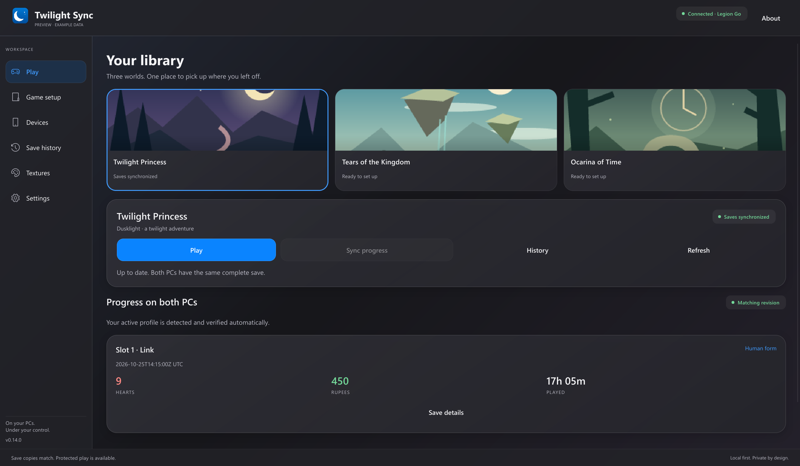

# Twilight Sync

## Your adventures. Any PC.

**A home for your native Zelda games—and the progress you don't want to leave behind.**

Install, update, or build supported PC projects. Pick an adventure from a
glass-style **Slint** library with light, dark, and system appearances.
Move between your desktop and Windows
handheld with private, encrypted save sharing over your home network.

**No cloud account. No subscription. No choosing a save folder.**

[**Download for Windows**](https://github.com/false00/twilight-sync/releases/latest)
&nbsp;·&nbsp; [Get started](#up-and-playing)
&nbsp;·&nbsp; [Report a problem](https://github.com/false00/twilight-sync/issues)

**Windows 10/11 x64** · **Desktop + handheld** · **Encrypted LAN** · **Offline play**

<picture>
  <source media="(prefers-color-scheme: light)" srcset="assets/interface-light.png">
  
</picture>

*The new Slint interface, shown with synthetic example data.*

| Twilight Princess | Tears of the Kingdom | Ocarina of Time |
|:---:|:---:|:---:|
| [Dusklight](https://twilitrealm.dev/) | [TotK Recomp](https://github.com/valentderah/totk-pc-recomp) | [Triforce](https://git.triforceproject.com/triforce/source) / [Longshot](https://git.magicbean.dev/MagicBeanDev/Longshot) |

*Original adventure artwork used in the interface. Games, Nintendo artwork,
ROMs, and console keys are not included.*

---

### Less setup. More adventure.

- **One place to play.** A calm game library, clear status, and large,
  touch-friendly controls for your desktop or handheld.
- **Your choice of installation.** Use official releases where supported,
  or review a source revision and build your own copy.
- **Choose your OOT project.** Switch between Triforce and Longshot beside Play
  or in Game setup. Both build locally from source and update independently.
  Switching carries verified progress across, with backups of replaced saves.
  A completed OOT session awaiting your offline PC's acknowledgment does not
  block switching.
- **Bring your own game files once.** Explicitly approve encrypted transfers of
  OOT `.nup` and TotK base/update `.nsp` files between your paired PCs.
  Console `prod.keys` has a separate, default-off permission and approvals.
- **Pick up where you left off.** Pair two PCs once. Share saves over your
  private LAN, without uploading them to a cloud service.
- **Offline is welcome.** Keep playing here. Reconnect later to sync or
  compare the progress from both PCs.
- **See before you choose.** Compare verified save information such as hearts,
  rupees, and play time where the game's format supports it.
- **Keep a way back.** Complete save branches, compact history, and rollback
  copies protect against an accidental choice. Different progress never
  silently picks a winner.

## Install in one command

Open **PowerShell as your normal Windows user** and run:

```powershell
irm https://raw.githubusercontent.com/false00/twilight-sync/main/install.ps1 | iex
```

The installer downloads the latest stable app, checks its published SHA-256,
adds one Twilight Sync desktop icon and a Start-menu entry, and opens Twilight Sync. Existing saves, pairing,
texture libraries, and startup preferences stay in place.
Rerunning it also opens an already up-to-date app. Unchanged desktop shortcuts
owned by Twilight Sync are repaired after an app move; customized shortcuts
are preserved rather than overwritten.

You do **not** need Rust, Visual Studio, Python, or .NET to run the downloaded
app. Building games from source has additional requirements, explained in the app.

> **Before you run it:** remote install commands execute code as your user.
> [Read the installer](install.ps1) first if you prefer. The app is currently
> unsigned, so Windows or a managed-device policy may block it. Checksums
> verify downloads—not publisher trust. Do not disable Windows security controls.

<details>
<summary><strong>Prefer a manual download?</strong></summary>

1. Open the [latest release](https://github.com/false00/twilight-sync/releases/latest).
2. Download `twilight-sync-windows-x86_64.exe` and `SHA256SUMS.txt`.
3. Check the executable:

   ```powershell
   Get-FileHash .\twilight-sync-windows-x86_64.exe -Algorithm SHA256
   ```

4. Compare the result with the matching line in `SHA256SUMS.txt`.
5. Keep the executable in a stable location and open it.

Windows x64 means Intel/AMD PCs and Windows handhelds. ARM64 release binaries
are not currently provided. PowerShell 5.1 and PowerShell 7 are supported,
including 32-bit PowerShell running on x64 Windows.

</details>

## Up and playing

### 1. Choose your adventure

Open **Game setup**, choose a game, and select an installation method:

| Project | Official install / updates | Build locally | Your local inputs |
| --- | :---: | :---: | --- |
| **Dusklight** | Yes | Yes | Your supported Twilight Princess GameCube disc dump for gameplay; compiling the engine itself needs no game assets |
| **TotK Recomp** | Yes | Yes | Your base game, supported update, and your console's `prod.keys` |
| **Triforce / OoT** | Source workflow | Yes | Your supported `.nup`, or retained `romfs` and `exefs` files from an existing installation |

First-time official TotK setup runs **inside the managed workflow**. Select
your local inputs and choose **Install / update**—there is no separate manual
installer to run first.

To copy inputs from your paired PC, open **Settings > Game-file transfers** on both PCs,
select the game, enable its file-sharing permission, and offer a selected file. The receiver
approves a new destination; existing files are never overwritten. Received
files become setup inputs, not automatic installations. Console-key transfers
require separate approval and save an unencrypted local file. Only share your
own games and keys with your own trusted paired PC.

Managed games use stable `Games\Dusklight`, `Games\TotKRecomp`, and `Games\Triforce`
folders. Existing managed version folders migrate when games, reservations and
transfers are idle. The previous container, superseded versions and old build
workspaces are then removed rather than kept as backups. Custom
installations and occupied unmanaged destinations are never overwritten.
**Game setup** shows the recorded installed version, whether a candidate is newer
or older, and source-to-source comparison links when both revisions are known.

### 2. Play here

Open **Play**, select a game, and choose **Play**. The app detects supported
save locations automatically and explains when a session, transfer, or
verification needs attention.

Use the single **Twilight Sync** desktop icon and choose a game from **Play**
for protected play checks. **Settings > Desktop shortcut > Create / repair desktop
shortcut** restores it at any time. App startup (including after updates) restores
a missing icon; separate game icons are no longer created. Launching a game
directly is outside the manager's control.

### 3. Bring your other PC along

On **both PCs**:

1. Join the same private home network.
2. Open **Devices**, review the displayed router, and approve that network.
3. Open pairing. On **one PC**, select the other device.
4. Compare the **entire code** on both screens. Both PCs must approve it.

That's it. Matching progress stays simple; different progress gets a clear
choice. You can compare complete branches, keep both and play here, or restore
an earlier snapshot from **Save history**.

Allow Twilight Sync on **Private networks only** if Windows Firewall asks.
Guest Wi-Fi, VPN routing, and client isolation can prevent local discovery.
The app does not open router ports or create public firewall rules.

## Want to build from source?

Choose **Build from source** in **Game setup**, then follow three focused steps:

1. **Tools:** check prerequisites, prepare verified build tools, and review the
   exact source commit. Missing .NET/MSYS2 prerequisites offer approved setup
   actions and copyable commands.
2. **Game files:** choose your own supported local inputs. Builds reuse these
   selections; nothing is sent to your paired PC automatically.
3. **Build:** review the settings, approve the scripts, and build your copy.
   Progress, retained logs, and safe cancellation are available.

Approval applies to the exact revision and build settings. Changing either
requires a fresh review.

For manual paired transfers, open **Settings > Game-file transfers** and choose
**Dusklight** (ISO/RVZ), **TotK** (NSP/console keys), or **OOT** (NUP). It reuses
the build's selected files. Enable the matching permission on both PCs, then
offer the file; the receiver approves a new destination.

**Important:** slower is **not confirmed safer**. Source code, build scripts,
compilers, and dependencies run with your Windows account's permissions.
This is not a sandbox. Use a separate VM for code you do not trust.

Native builds need at least **64 GiB free**, plus room for copied local data;
the complete process can take an hour or more. Temporary workspaces are cleaned
up after the build, and TotK keeps the setup it needs for in-game mod rebuilds.
Saves, mods and settings are copied into the new build before it is selected.
Once games are idle, the previous build, install backups and older workspaces
are removed, and TotK's prepared shaders are warmed in the graphics driver's
cache for the folder it now runs from. Shader preparation may open a window,
but normal gameplay does not start as part of the build.
Newer builds awaiting activation and their mod-rebuild workspaces are kept,
including after restarting Twilight Sync.

Triforce builds include their required Vulkan/SDL and movie/audio dependencies.
Optional graphics controls are separate from what the game needs to run.
Codec SDK data comes from **Takoroka/ffmpeg-av1**, not FFmpeg.org; a matching
checksum is not source-to-binary attestation.

## A few good things to know

<details>
<summary><strong>Can I play without my other PC?</strong></summary>

Yes. Local progress stays on this PC. When both devices return, matching
branches can sync and divergent progress is preserved for comparison.
A stored protected-play reservation still needs normal completed-session
recovery; closing the app does not silently remove that protection.

</details>

<details>
<summary><strong>What gets shared?</strong></summary>

The supported game's verified, committed save data—not console keys, mods,
graphics settings, or unrelated accounts. The games have separate save
channels, histories, and play reservations.

Optional verified GameCube ISO/RVZ transfer requires separate consent on each
PC and for each incoming transfer. Game downloads are never supplied.

</details>

<details>
<summary><strong>Where did the window go?</strong></summary>

Closing the window keeps Twilight Sync available in the system tray.
Double-click its moon icon to reopen it. Use **Quit** when you want to stop
the manager, after finishing any game or installation.

</details>

<details>
<summary><strong>Something failed. What should I do?</strong></summary>

Read the visible error and use **Open build log** for a source failure.
After installing SDKs with copied commands, use **Check source & tools** again.
Do not delete your saves, clear reservations blindly, or repeatedly reinstall
an SDK that is already marked **Found**.

If you [report an issue](https://github.com/false00/twilight-sync/issues),
include the app version and relevant error text. Remove private paths or
personal information, and **never attach console keys, game assets, or saves
you do not intend to share publicly**.

</details>

## Security: private by design

Encryption is only one layer. Twilight Sync combines an explicitly approved
network, authenticated devices, narrowly scoped transfers, and save-replacement
checks. Your paired PC is trusted to share supported game data—not to run
commands or choose arbitrary files on your machine.

### A private connection, with an identity you verify

- **Your LAN is an explicit boundary.** Sync requires a physical adapter on a
  Windows **Private** IPv4 network, a directly connected subnet, and your
  approval of the router/subnet fingerprint. Connections bind to that interface;
  router changes or stale verification stop network activity. There is no
  Internet relay, router port forwarding, or public-network fallback.
- **Both PCs approve the same session.** First pairing opens a two-minute,
  attempt-limited window. Compare the **entire eight-digit code** on both PCs:
  it comes from that exact handshake, not a reusable password. Both PCs must
  approve and persist the pairing before saves or play reservations are accepted.
  Discovery names alone are never proof of identity.
- **The channel is encrypted and authenticated.** `twilightProto/1` uses
  **Noise XX** with **X25519, ChaCha20-Poly1305, and SHA-256**, providing forward
  secrecy and authenticated encryption. Each direction rekeys after **4,096
  authenticated events**. Modified or replayed ciphertext is rejected.
  Reconnection must match the full pinned device public key—there is no silent
  key replacement.

### Permission to sync is not permission to overwrite anything

- **Only supported, validated data crosses the save channel.** Bounded,
  game-scoped messages carry committed saves, not executables, mod scripts,
  console keys, or arbitrary folders. Save structure, supported identities,
  checksums, and transfer hashes are checked. Optional verified GameCube disc
  transfer has separate ownership/permission settings and per-transfer consent.
- **The receiving PC controls the destination.** Paths come from its own
  detected game profile. Unsafe paths and reparse points are rejected; the
  expected current save is checked again before replacement. Writes are staged,
  verified, and committed with rollback protection rather than blindly copying
  over a live save.
- **Different progress is a decision, not a timestamp race.** Automatic sync
  depends on agreed common-save state. Divergent branches require an explicit
  choice and receiver approval; neither branch is silently declared the winner.
  Content-addressed history retains prior progress within its storage budget.
  Games have separate save channels, histories, and play reservations.
- **Play protection survives a disconnect.** Managed online launches coordinate
  durable reservations on both PCs. A timeout, app restart, or lost connection
  does not silently unlock a session. Recovery is an explicit completed-session
  workflow, not an expiring lease.

### What this does—and does not—protect

The private device key is protected at rest with **Windows current-user DPAPI**,
and application-data permissions are restricted. **Saves and snapshot history
are not encrypted at rest.** Local audit logs contain usernames, paths, hashes,
public peer identities, and security decisions; redact them before sharing.
The manager does not log private keys, save payloads, or pairing codes.
Discovery exposes the device name, public key, network tag, and pairing
availability to the local network.

This is an **early release, not an independently audited security product**.
Router fingerprints can be spoofed; they supplement, not replace, device
authentication. A structurally valid save can still target a game-engine bug.
Direct game launches can bypass cooperative play protection, and offline play cannot
guarantee the other PC is idle. DPAPI and encryption do not defend against
malware running as your user, an administrator, or a compromised OS.

App/tool checksums verify download integrity, not publisher trust or the absence
of malicious code. Approved source-build scripts run with your Windows account's
permissions, can make their own network requests, and may print sensitive data
to build logs. They are **not sandboxed**. Keep independent save backups and use
a separate VM for code you do not trust.

[Read the protocol, validation rules, and security boundaries](docs/guide.md#twilightproto1-the-protocol).

## For contributors

Twilight Sync is a Rust application with a Slint interface. The sync engine,
history, and protected-play checks are independent of the UI.

- [Development and validation](docs/development.md)
- [Detailed user and technical guide](docs/guide.md)
- [Supported native save details](docs/totk-save-details.md)
- [Third-party acknowledgements](docs/acknowledgements.md)
- [Project license](LICENSE) and [third-party notices](THIRD_PARTY_NOTICES.txt)

Original project code is MIT-licensed. Slint and other dependencies retain
their own licenses; required attribution is on the
[acknowledgements page](docs/acknowledgements.md), not a sponsorship.
Third-party licenses remain available from **About**.
Twilight Sync is not affiliated with Nintendo or the upstream game
projects. Supply only game files you are legally entitled to use.
